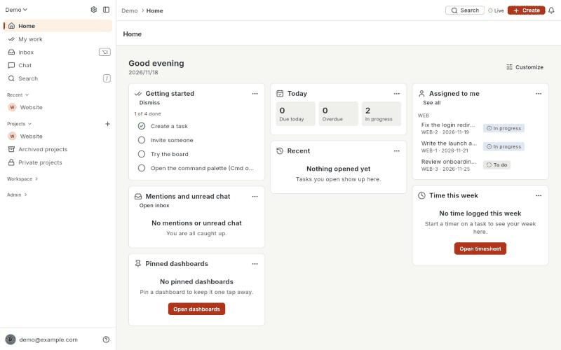
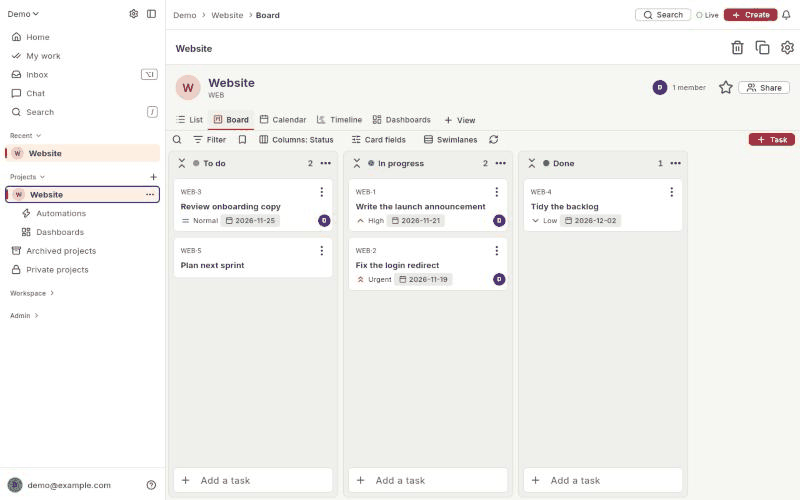
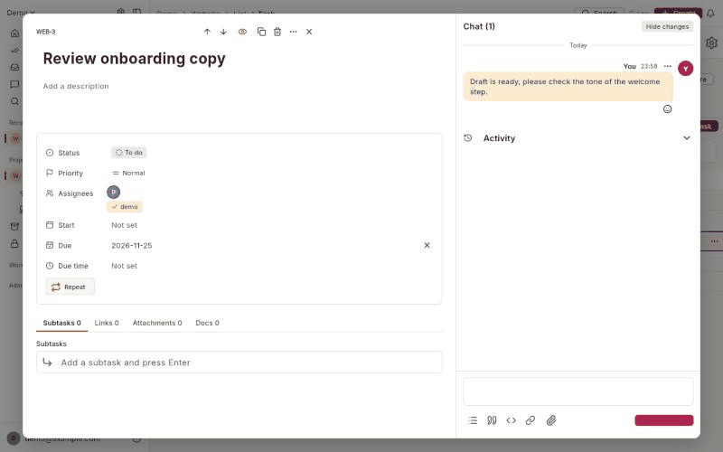

# TaskForge

A free, self-hostable alternative to **Jira** and **ClickUp** — no paywalled basics,
fast, offline-capable, and consistent on web, mobile and desktop.

- **Client:** Flutter (web, mobile, desktop)
- **Backend:** Django Ninja (REST) + gRPC (typed data/streaming) + WebSocket (realtime)

## Start here

1. [docs/00-vision-and-gaps.md](docs/00-vision-and-gaps.md) — what Jira/ClickUp get wrong and how we fix it
2. [docs/01-architecture.md](docs/01-architecture.md) — how the three transports fit together
3. [docs/02-roadmap.md](docs/02-roadmap.md) — ordered list of phases
4. [docs/phases/](docs/phases/) — one document per phase, one feature each

## Screenshots

Captured from the running web app against a seeded demo workspace (`make seed`; demo data only).

| Home | List |
|------|------|
|  |  |
| **Board** | **Task** |
|  |  |
| **Dark mode** | **Persian (right to left)** |
|  |  |

Status: **planning complete; phase 00 (foundation) implemented.** See [AGENTS.md](AGENTS.md#commands) to run it.
